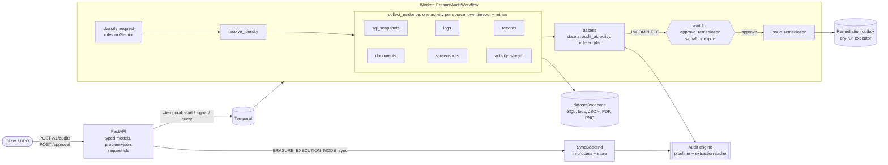

# GDPR Erasure Audit Agent

[](https://github.com/sabha348/gdpr-erasure-audit-agent/actions/workflows/ci.yml)

## Hackathon origin

Ranked 1,073 of 4,094 in HackerRank Orchestrate (Oct 2026). Submission preserved at tag `hackerrank-orchestrate-submission`. Everything after that tag is post-hackathon work.

## CI status

The GitHub Actions pipeline (`.github/workflows/ci.yml`) has not run yet: GitHub has not started the jobs
because of an account billing lock, not because of a failing check, which is why the badge above is red. It
will run unchanged once that is resolved. Until then, the same steps were run locally on 2026-11-15 at commit
`a46424c`:

| CI job | local command | result |
|---|---|---|
| lint and type-check | `ruff check src tests scripts`, `mypy` | clean, 22 files type-checked |
| tests (Python 3.11 / 3.12 / 3.13) | `pytest --cov=erasure_audit` | 82 passed on each, 81% coverage |
| evaluation gate | `erasure-audit eval --cv --min-verdict-accuracy 1.0 --min-step-f1 0.943` | passed: verdict 100%, step F1 94.3% |
| image and compose smoke test | `docker build`, golden output in the container, `docker compose up --wait`, `scripts/smoke.py` | output byte-identical, stack healthy, SMOKE PASSED |

To reproduce: `make lint test eval`, then `make up smoke`.

## What it does

A deletion workflow can report *Complete* while a person's data is still in database replicas, logs, exports,
support attachments, search indexes or backups, and sync or restore jobs can quietly bring it back. For one
erasure request, this service:

1. **Checks that the request authorises deletion.** It uses multilingual rules or a Gemini classifier; access,
   export, correction and marketing opt-outs are `NOT_APPLICABLE`.
2. **Resolves the person.** It works from current and historical emails and email hashes, using the identity
   audit log.
3. **Collects every evidence source:** SQL replica snapshots, logs, JSON/TXT records, PDFs, screenshots and the
   global activity stream.
4. **Rebuilds each linked record's state at the audit time.** Workflow results count as claims, not proof.
5. **Applies the deletion policy.** Depending on the record it is deleted, redacted, anonymised, retained, or
   kept as an account tombstone.
6. **Returns a verdict and a plan.** The verdict is `COMPLETE`, `INCOMPLETE` or `NOT_APPLICABLE`. The plan is
   an ordered list of findings, remediation and verification steps, each finding citing its evidence.
7. **Waits for a human.** Remediation is issued only after someone approves it.

## Architecture



- **Extraction** (`extraction/`) turns each evidence file into structured observations, once, cached by file
  hash. SQL dumps run in a locked-down in-memory SQLite, with `ATTACH` denied. Logs are parsed with
  per-format regexes, PDFs with `pdfplumber`, and screenshots with a vision model.
- **Audit engine** (`pipeline/`) is deterministic: identity resolution, evidence linking, state reconstruction
  at `audit_at`, policy and step planning. Every judgment call is a named option, and every uncertain
  decision is listed in the result's `diagnostics.low_confidence`.
- **Service layer:** an `AuditService` holds the loaded engine. Behind it, the `AuditBackend` interface (sync
  or Temporal) and the `RemediationExecutor` interface (dry-run outbox) are the integration points.

## Quickstart

```bash
pip install -e '.[dev]'                 # Python 3.11+
erasure-audit run                       # all 518 requests -> output.csv (about 1 s)
erasure-audit eval --cv                 # labelled-case evaluation -> eval/results/<timestamp>/
erasure-audit serve                     # HTTP API in sync mode on :8000 (OpenAPI docs at /docs)
pytest                                  # 82 tests: golden, unit, API, Temporal workflows
```

The full stack (Temporal dev server with UI, worker, API):

```bash
make up                                 # docker compose; API :8000, Temporal UI :8233
make smoke                              # submit -> AWAITING_APPROVAL -> approve -> REMEDIATION_ISSUED
make down
```

```bash
curl -s localhost:8000/v1/audits -H 'content-type: application/json' -d @request.json    # 201, result + plan
curl -s localhost:8000/v1/audits/audit-case_05/approval -H 'content-type: application/json' \
     -d '{"decision": "approve", "approver": "dpo@example.com"}'                          # REMEDIATION_ISSUED
```

Configuration is environment-only (see `src/erasure_audit/settings.py` and `.env.example`). The Gemini classifier
is opt-in: set `ERASURE_CLASSIFIER=llm` and `GEMINI_API_KEY`, or the alias `GOOGLE_GENERATIVE_AI_API_KEY`.

## Evaluation

The labelled set is the 32 official public answers (`dataset/sample_output.csv`). No labels were invented.
Because the option defaults were tuned on these cases, their score is **in-sample**, so it is reported next
to a **leave-one-out** estimate. Owner-written held-out cases go in `eval/cases/custom/` and are reported as
their own slice. Method: [docs/evaluation.md](docs/evaluation.md).

| metric | in-sample | leave-one-out held-out |
|---|---|---|
| verdict accuracy | 100% | 100% |
| step precision / recall / F1 | 98.3% / 90.7% / 94.3% | 98.3% / 90.7% / 94.3% |
| remediation-step F1 | 100% | 100% |
| exact ordered plan | 18 / 32 | 18 / 32 |
| plan validity (flows and restores before records, every fix verified) | 100% | n/a |

In every leave-one-out fold, re-running the option sweep from untuned options picked exactly the shipped
defaults, so the option tuning does not overfit individual cases. The missing recall comes from records that
no visible evidence links to the person, mostly verification steps for accounts that appear in no input file.

| classifier | verdict | step F1 | tokens / case | cost / case | latency p50 / p95 |
|---|---|---|---|---|---|
| rules (default) | 100% | 94.3% | 0 | $0 | 0.3 ms / 0.6 ms |
| Gemini 3.6 Flash, zero-shot, prompt v1 | 84.4% | 89.2% | 317 | $0.0004 | 6.1 s / 202 s (free-tier 429 backoff) |

Prompt v1 missed "please verify my deletion" follow-ups. The spec treats deletion verification as authorised,
and prompt v2 adds that rule. A v2 score is still pending a free-tier quota window. On this dataset the rules
beat the zero-shot model, so the model is used as a second opinion: a disagreement flags the case for review.

CI runs the evaluation on every push and fails below verdict 100% or step F1 0.943.

## Design decisions

- **Determinism is a feature.** The full 518-case output is pinned byte for byte (`tests/golden/output.csv`)
  and must not depend on the hash seed. That test caught a real bug: the hackathon account join depended on
  `PYTHONHASHSEED`.
- **Evidence beats claims.** A workflow's "SUCCESS" is a claim. Only observations (snapshots, checks, files)
  establish state, and absence is proven by omission only from snapshots that list a store's full contents.
- **Each evidence source is a Temporal activity** with its own timeout and retry policy. Unreadable sources
  are retried; corrupt or changed ones are not. If a source can't be read, the audit fails closed: it is
  never `COMPLETE` with a source unread. A test shows that collecting every source gives exactly the
  in-process answer on all 550 requests.
- **Human in the loop by construction.** `INCOMPLETE` audits wait for an `approve_remediation` signal, with an
  expiry. Remediation goes through an idempotent executor, so retries and replays never issue a plan twice.
- **Idempotency from the domain key.** The audit id is `audit-<case_id>` in both backends: an identical
  resubmit returns the existing audit, and a different request on the same id is a 409.
- **One API, two backends.** Sync mode is for tests, demos and single-node use; Temporal mode is durable. A
  real compose run showed the payoff: a worker hit a permission error and Temporal kept retrying, and the
  audit finished by itself once the volume was fixed.
- **12-factor configuration.** Settings come from the environment, keys are `SecretStr`, and the image runs as
  a non-root user with a warm extraction cache baked in.

More: [docs/workflows.md](docs/workflows.md) (sequence diagram, retry table), [docs/api.md](docs/api.md),
[docs/DECISIONS.md](docs/DECISIONS.md) (evidence-reasoning decisions), [docs/approach.md](docs/approach.md)
(hackathon write-up).

## Layout

```
src/erasure_audit/
  extraction/     per-format parsers, LLM client (usage capture, pricing), prompts, cache
  pipeline/       data loading, classifier (rules / LLM), evidence interpretation, assessment, sources
  evaluation/     labelled cases, metrics, runner, leave-one-out CV, report, validator
  api/            FastAPI app, routes, middleware, errors, sync and Temporal backends
  workflows/      ErasureAuditWorkflow, activities, worker
  models.py  settings.py  service.py  remediation.py  cli.py  contract.py
tests/            golden, unit, api, workflows
eval/             case schema, custom (held-out) cases
docs/             evaluation, api, workflows, decisions, OpenAPI schema, challenge archive
```

## Limitations and next steps

- **Ad-hoc requests get evidence-based linking only.** The cross-request account join needs the whole batch
  of requests up front, so requests outside the dataset skip it.
- **The held-out slice is empty until labelled cases are added.** Rules written by reading the samples (for
  example the account join) can only be measured on genuinely new cases.
- **Sync-mode records live in memory.** Temporal mode is the durable path.
- **The remediation executor is a dry run.** A real integration would consume the outbox.
- **Possible next steps:** a Temporal Update instead of a signal, for synchronous per-caller approval answers;
  search attributes for listing audits at scale; scoring Gemini prompt v2.

The dataset in `dataset/` is the fictional challenge dataset published by HackerRank. The original challenge
files are in [docs/challenge/](docs/challenge/).
