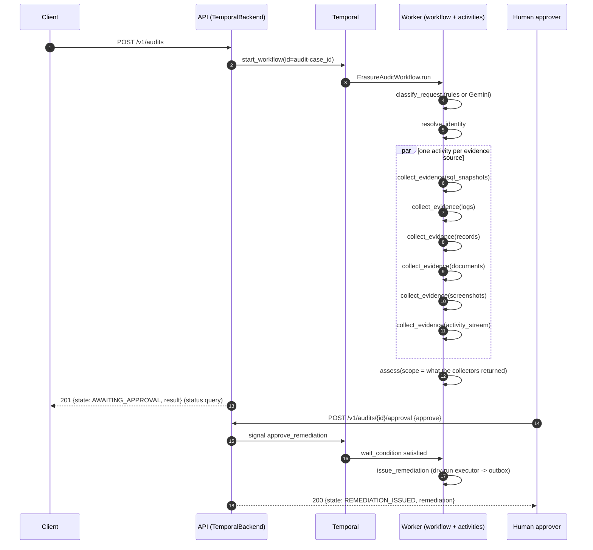

# Temporal workflows

With `ERASURE_EXECUTION_MODE=temporal`, every audit is one durable `ErasureAuditWorkflow` (workflow id
`audit-<case_id>`). The API starts it, signals it and queries it. A separate `erasure-audit worker` process
runs it.

```bash
temporal server start-dev                                  # or the compose stack (M4)
ERASURE_EXECUTION_MODE=temporal erasure-audit worker
ERASURE_EXECUTION_MODE=temporal erasure-audit serve
```

## Sequence



Audits that are COMPLETE or NOT_APPLICABLE end as `COMPLETED` without waiting. If no decision arrives within
`ERASURE_APPROVAL_TIMEOUT_S` (default 7 days), the audit becomes `EXPIRED`.

## Activities, timeouts and retries

| activity | start-to-close | overall | retry policy | not retried |
|---|---|---|---|---|
| `classify_request` | 90 s | 10 min | 5 s initial, ×3, max 2 min, 4 attempts. A transient model error is raised until the last attempt, then the rules fallback is accepted | — |
| `resolve_identity` | 10 s | — | 1 s initial, 3 attempts | — |
| `collect_evidence` ×6 | 60 s | 5 min | 1 s initial, ×2, max 30 s, 5 attempts | `EvidenceCorrupt` (file changed since extraction, or failed extraction) |
| `assess` | 60 s | — | 1 s initial, 3 attempts | — |
| `issue_remediation` | 30 s | 1 h | 2 s initial, ×2, max 1 min, unlimited within 1 h | — |

## Design decisions

- **Each evidence source is its own activity.** Each collector re-reads its source and checks every file
  against the hash it was extracted from. In production, this is where a database replica, a log store or
  object storage would be queried, so this is where timeouts and retries belong. One slow or flaky source is
  retried on its own, without redoing the others.
- **Fail closed.** If a source still fails after its retries, the audit ends `FAILED` with the source named.
  The agent never reports COMPLETE with a source unread. The workflow itself completes normally, so the
  record stays queryable.
- **Scope equivalence.** `assess` uses only the files and activity rows the collectors returned. A test
  shows that collecting every source gives exactly the in-process answer on all 550 requests, and that
  dropping a source changes answers, which proves the scope is enforced.
- **Deterministic workflow code.** The workflow does no I/O, reads no clocks except `workflow.now()` and
  uses no randomness. A replay test re-runs a recorded history against the code.
- **Signal for approval.** The first decision on an `AWAITING_APPROVAL` audit wins and later signals are
  ignored. The API checks the state before signalling and returns 409 otherwise. A Temporal Update would
  let the workflow validate and answer each caller synchronously; a signal plus a query was chosen because
  the requirement named a signal and it keeps the API backend-agnostic.
- **Idempotency everywhere.** The workflow id is derived from `case_id` (REJECT_DUPLICATE), and the executor
  returns the first ticket on a repeat, so retries and replays never issue a plan twice.
- **Workflow state is the store.** The `status` query returns the `AuditRecord`, so temporal mode needs no
  database. The cost is that listing audits uses workflow visibility plus one query per audit, which is fine
  at this scale. At larger scale, I would add search attributes for the state.

## Tests

`tests/workflows/` runs against Temporal's time-skipping test server (and a local dev server for the HTTP
test). It covers:

- all 32 samples through the workflow (equal to the pipeline);
- approve, reject, and a late second signal;
- a week-long approval timeout leading to EXPIRED;
- a source that fails twice and is retried (attempts 1, 2, 3);
- a corrupt source that fails the audit closed;
- deterministic replay;
- HTTP in temporal mode, end to end.
